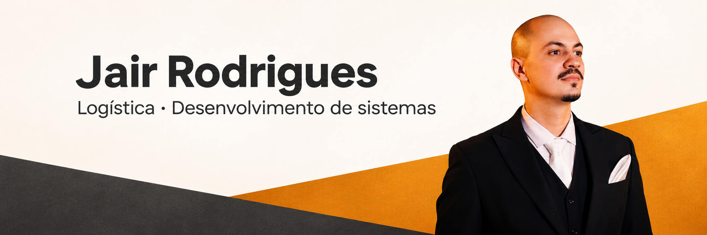

Sou supervisor de logística na Fromtherm. Sempre gostei de desenvolver e comecei criando aplicativos no Glide. Hoje também trabalho na nossa Intranet.

Nos meus projetos pessoais, desenvolvo sistemas para pequenas empresas, como marmorarias, marcenarias e negócios do setor náutico. Crio aplicativos para fazer orçamentos, controlar estoque e vendas e acompanhar pedidos.

Trabalho tanto na estrutura dos sistemas quanto na interface. O front-end é a parte que mais gosto, porque ali posso pensar em como a tela fica e em como as pessoas encontram o que precisam.
